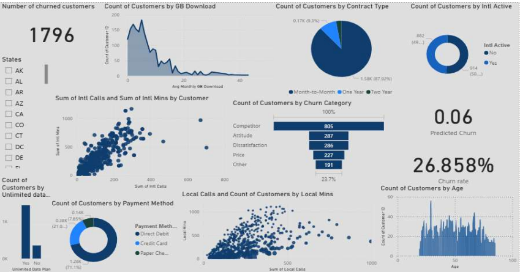

# Telecom Customer Churn Analysis

A telecom company lost **1,796 of 6,687 customers (about 27%)**. This project finds who leaves and why, then turns the findings into retention actions.

<!-- TIP: re-export the dashboard at full-screen resolution. The current image is 849 x 445. -->

---

## Business Problem

Reducing churn is a growth strategy, not just a cost-saving one. Retention teams need to know which customers are at risk and what drives them away, so they can spend offers and support effort where it matters.

---

## What I Did

1. **Profiled and cleaned the data**
   - Fixed wrong churn labels: some churned customers were labeled `No`.
   - Split the churned customers into their own table for analysis.
   - Found that many churned customers had no recorded churn reason (see [Limitations](#limitations)).
2. **Built an interactive Power BI dashboard** with churn rate, churn category, contract type, payment method, usage, international activity and geography.
3. **Analyzed churn drivers** and wrote a stakeholder proposal with recommendations: [`Customer_Churn_Proposal.pdf`](Customer_Churn_Proposal.pdf).

<!-- VERIFY: write the tools you really used for cleaning (Power Query, SQL, Excel). The CV says SQL, but this repo has no SQL file. Add the script, or remove SQL from the CV. -->

---

## Key Findings

| Area | What the data shows |
|---|---|
| Contract type | Month-to-Month contracts churn the most; annual contracts churn less |
| Payment method | Credit card users are the most stable; Direct Debit and Paper Check users churn more |
| Usage | Churned customers make fewer calls and use fewer minutes, but use more mobile data and are more often on the Unlimited plan |
| International | Many churned customers used international calls without an international plan |
| Support | Churn is higher among customers who contacted customer support |
| Geography | Ohio, Maryland and California show higher churn; New York, Minnesota and Wisconsin show stronger retention |
| Reasons | Competitor is the largest churn category, followed by perceived poor value, unexpected charges and service experience |

---

## Recommendations

1. **Payments:** promote credit card and online payments; contact Direct Debit and Paper Check users early when billing problems appear.
2. **Contracts:** reward annual contracts; give flexible perks to Month-to-Month customers.
3. **Regions:** add support and targeted offers in high-churn states.
4. **International use:** offer tailored international plans and usage alerts.
5. **Data usage:** improve Unlimited plans and warn customers before they hit high usage.
6. **Support:** contact high-risk customers before they leave and fix issues fast.
7. **Next step:** build a predictive model to flag at-risk customers (not built yet).

---

## Limitations

- **Missing churn reasons were filled with `Price`** as the most likely cause. This is an assumption, so the Price category is larger than what customers actually reported, and the "focus on price" recommendation partly rests on it. A stricter version would label these rows `Not recorded`.
- The data is imbalanced: far fewer churners than non-churners.
- The findings show associations, not proven causes.
- This is a descriptive analysis; no predictive model was built.

---

## Files

| File | Description |
|---|---|
| `Dashboard.png` | Dashboard snapshot |
| `Customer_Churn_Proposal.pdf` | Stakeholder deck with findings and recommendations (20 slides) |
| `telecom_churners.xlsx` | Dataset <!-- VERIFY: original or cleaned? say which --> |

---

## Author

**Abdallah Tarek**, Data Analyst
[LinkedIn](https://www.linkedin.com/in/abdallaatarekk) · [Portfolio](https://abdallahportfolio-phi-ten.vercel.app) · abdallahtarek.work@gmail.com
